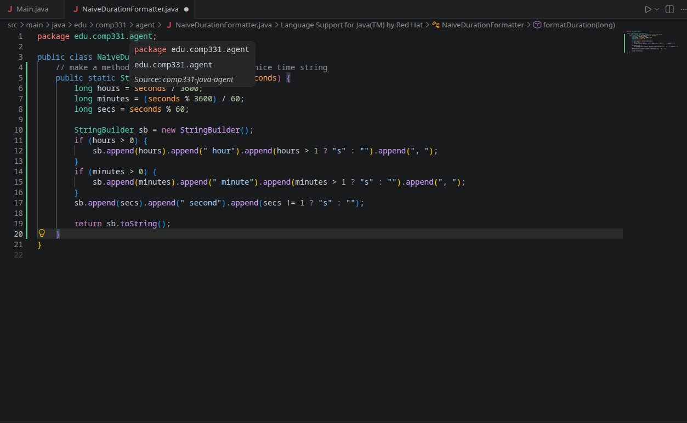
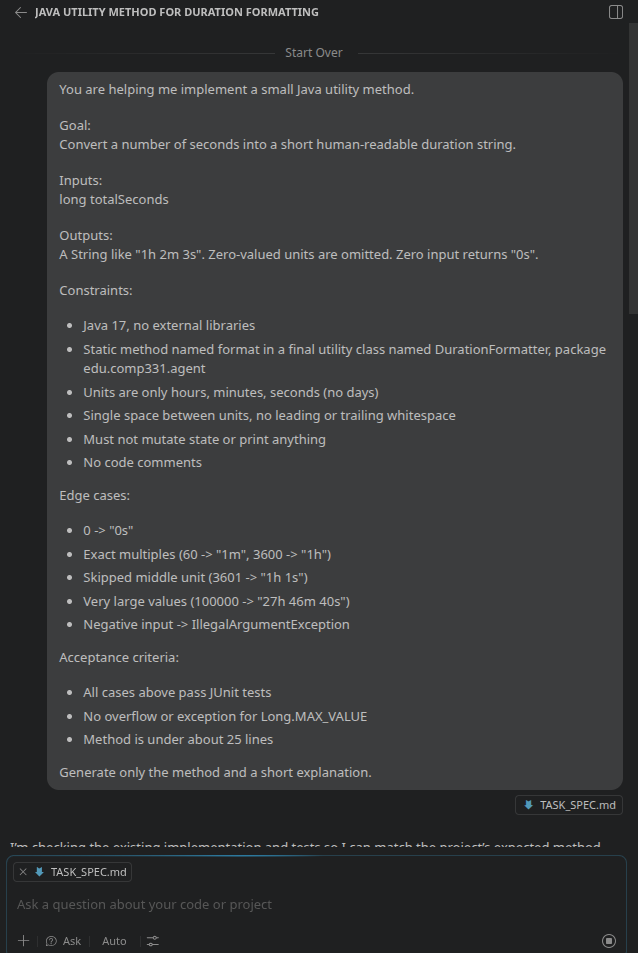
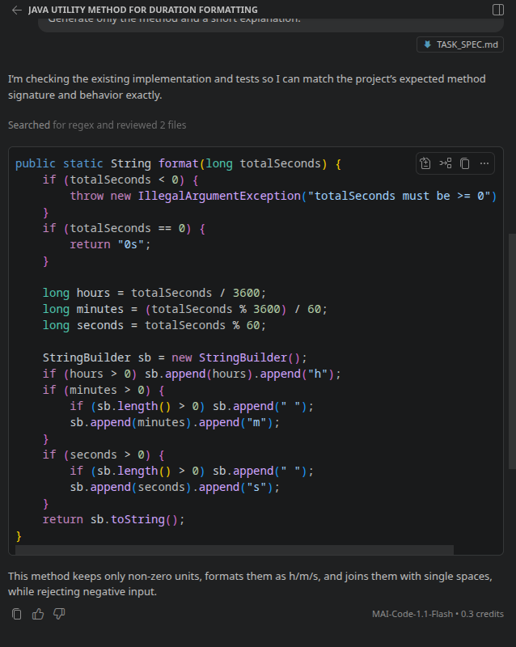
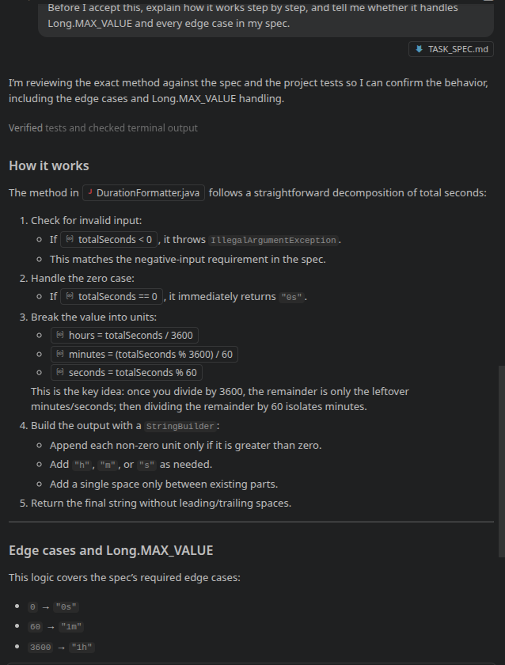
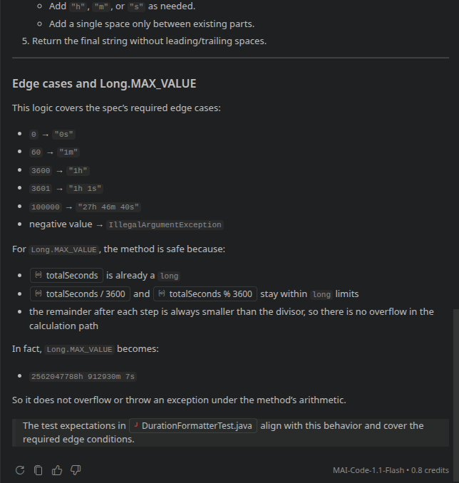

# comp331-java-agent

Lab 1: a Java command-line client for the Gemini API, plus a comparison of naive and structured prompting with GitHub Copilot.

## Setup

- Java 21 (JDK) and Maven 3.9.x
- A Gemini API key from Google AI Studio, set as an environment variable. No keys or `.env` files are committed.

```
export JAVA_HOME=/usr/lib/jvm/java-21-openjdk
export GEMINI_API_KEY="your-key-here"
```

The model is set in `Main.java` as `gemini-3.5-flash-lite`.

Model notes: `gemini-2.5-flash` returned a 404 (no longer available to new users). `gemini-3.8-flash` worked intermittently but returned 503 "high demand" errors and one request timeout. I listed the models available to my key with the `models` endpoint and switched to `gemini-3.5-flash-lite`, which responded reliably.

## Run commands

```
mvn test
mvn exec:java -Dexec.args="Why are structured prompts useful for Java development?"
mvn exec:java -Dexec.args="--verbose Explain what this program does"
```

Verbose output (final model):

```
[verbose] model:  gemini-3.5-flash-lite
[verbose] prompt: Explain what this program does
It looks like you forgot to include the program!

Please paste the code here, and I would be happy to explain what it does, line by line if needed.
[verbose] tokens: prompt=6 output=35 total=41
```

Example from an earlier run on `gemini-3.8-flash`:

```
[verbose] model:  gemini-3.8-flash
[verbose] prompt: Explain what this program does
[verbose] tokens: prompt=6 output=37 total=80
```

The token counts do not add up (6 + 37 is not 80). The API reports `totalTokenCount` separately, and the difference is most likely internal reasoning tokens that count toward the total but are not part of the visible output. On the final model the counts add up (6 + 35 = 41), so no extra reasoning tokens were reported.

## Project structure

- `Main`: parses `--verbose` and the prompt from arguments, reads the API key from the environment, prints the response.
- `GeminiClient`: sends messages to the Gemini `generateContent` endpoint and parses the reply and token counts.
- `Message`: record with `role` and `content`, for later labs.
- `LlmResponse`: record holding response text and token counts.
- `DurationFormatter`: the structured implementation.
- `NaiveDurationFormatter`: the naive Copilot output, left as generated.
- `docs/TASK_SPEC.md`: the structured task specification.

## Commit history

1. `10a7337` Hard-coded prompt to verify the API connection.
2. `fea2b55` Prompt from command-line arguments and `--verbose` flag.
3. `73bba70` Naive Copilot attempt at duration formatting.
4. `2f95cb7` Structured Copilot implementation, spec update, and `Long.MAX_VALUE` test.

## Feature chosen

`format(long totalSeconds)` converts seconds into a duration string such as `1h 2m 3s`. The full specification (goal, inputs, outputs, constraints, edge cases, acceptance criteria) is in `docs/TASK_SPEC.md`.

## Naive Copilot interaction

Inline Copilot, with only this comment typed into an empty class:

```
// make a method that turns seconds into a nice time string
```

Result, accepted without edits (the comment was removed afterward to keep the code comment-free):

```java
public class NaiveDurationFormatter {
    public static String formatDuration(long seconds) {
        long hours = seconds / 3600;
        long minutes = (seconds % 3600) / 60;
        long secs = seconds % 60;

        StringBuilder sb = new StringBuilder();
        if (hours > 0) {
            sb.append(hours).append(" hour").append(hours > 1 ? "s" : "").append(", ");
        }
        if (minutes > 0) {
            sb.append(minutes).append(" minute").append(minutes > 1 ? "s" : "").append(", ");
        }
        sb.append(secs).append(" second").append(secs != 1 ? "s" : "");

        return sb.toString();
    }
}
```

During this attempt Copilot had no access to any other project file. It saw only the comment and the empty class, so it had no existing implementation or tests to draw from.

Evidence: [naive-copilot.txt](docs/evidence/naive-copilot.txt) contains the exact comment, Copilot's unedited output, and the jshell results.



I ran the naive method on the spec's edge cases with `jshell`:

| Input | Naive output | Spec expects |
| --- | --- | --- |
| 0 | `0 seconds` | `0s` |
| 45 | `45 seconds` | `45s` |
| 60 | `1 minute, 0 seconds` | `1m` |
| 61 | `1 minute, 1 second` | `1m 1s` |
| 3600 | `1 hour, 0 seconds` | `1h` |
| 3601 | `1 hour, 1 second` | `1h 1s` |
| 3723 | `1 hour, 2 minutes, 3 seconds` | `1h 2m 3s` |
| 100000 | `27 hours, 46 minutes, 40 seconds` | `27h 46m 40s` |
| -1 | `-1 seconds` | `IllegalArgumentException` |

## Structured Copilot interaction

I first tried Copilot Chat in Agent mode, which asked to run a bash command. I declined it, switched to Ask mode, and started a new chat so Copilot would only answer in the chat.

Prompt sent (built from the spec):

```
You are helping me implement a small Java utility method.

Goal:
Convert a number of seconds into a short human-readable duration string.

Inputs:
long totalSeconds

Outputs:
A String like "1h 2m 3s". Zero-valued units are omitted. Zero input returns "0s".

Constraints:
- Java 17, no external libraries
- Static method named format in a final utility class named DurationFormatter, package edu.comp331.agent
- Units are only hours, minutes, seconds (no days)
- Single space between units, no leading or trailing whitespace
- Must not mutate state or print anything
- No code comments

Edge cases:
- 0 -> "0s"
- Exact multiples (60 -> "1m", 3600 -> "1h")
- Skipped middle unit (3601 -> "1h 1s")
- Very large values (100000 -> "27h 46m 40s")
- Negative input -> IllegalArgumentException

Acceptance criteria:
- All cases above pass JUnit tests
- No overflow or exception for Long.MAX_VALUE
- Method is under about 25 lines

Generate only the method and a short explanation.
```

The chat did not fit in one screenshot, so it is split into four images:









Copilot's reply began by saying it was checking the existing implementation and tests, so it read my project files, including an earlier version of `DurationFormatter`. Its answer was therefore influenced by repo context as well as by the prompt. The naive attempt had no such context, so the two attempts differ in repo access as well as in prompt quality. This limits how cleanly they can be compared.

Before accepting, I asked Copilot to explain the method step by step and say whether it handles `Long.MAX_VALUE` and each edge case. The explanation is in the chat screenshots above.

The explanation of the logic was accurate. One example in it was wrong: Copilot said `Long.MAX_VALUE` becomes `2562047788h 912930m 7s`. That is impossible, because the minutes value is computed from a remainder below 3600 and so cannot exceed 59. I ran the method with `jshell` and got `2562047788015215h 30m 7s`. I also made an arithmetic mistake of my own when first checking this by hand, which running the code corrected. The method's conclusion (no overflow) was right.

## Accepted, rejected, and revised

- Accepted: Copilot's `format` method as written. It met every item in the spec.
- Revised: I added a no-comments constraint to `TASK_SPEC.md` before prompting.
- Added by me: a `Long.MAX_VALUE` test with the value verified by running the code, not taken from Copilot's explanation.
- Rejected: Copilot's example output for `Long.MAX_VALUE`, which was wrong.
- Declined: the bash command requested in Agent mode.

## Comparison: naive vs structured

- **Correctness:** The naive version printed `1 minute, 0 seconds` for 60 and `1 hour, 0 seconds` for 3600, because it always appends seconds. The structured version omits zero units and returned the expected strings in all tests.
- **Zero and negative input:** The naive version returned `0 seconds` for 0 and `-1 seconds` for -1 with no error. The structured version returns `0s` and throws `IllegalArgumentException`.
- **Format:** The naive version chose a verbose format (`1 hour, 2 minutes`). That was partly my fault, since the comment never specified a format. The spec made the format explicit.
- **Edge cases:** The naive version handled none of the spec's edge cases except the ordinary mixed values. The structured version covered all of them, plus `Long.MAX_VALUE`.
- **Human decisions:** With the naive prompt, I made no decisions and the output made them for me. With the structured prompt, I decided the format, the unit limit (no days), the exception behavior, and the no-comments rule, and I verified Copilot's explanation by running the code.

## Verification

- `mvn test`: `Tests run: 10, Failures: 0, Errors: 0, Skipped: 0`, `BUILD SUCCESS`.
- Manual runs of both `mvn exec:java` commands against the Gemini API.
- `jshell` runs of both formatter versions on the edge cases above.

## AI-assisted development evidence

- Inline Copilot comment and suggestion (naive): [docs/evidence/naive-copilot.txt](docs/evidence/naive-copilot.txt)
- Copilot Chat structured prompt, reply, and explanation before accepting: the four screenshots in `docs/screenshots/` shown in the structured section above
- Git history above shows each stage as a separate commit.

# Lab 2: Sandbox project and evaluation process

Lab 2: a small Java calculator sandbox with a repeatable JUnit evaluation, used to compare two Copilot-assisted iterations of the code.

## Sandbox

`sandbox/calculator` is a standalone Maven project (Java 17, JUnit 5) containing `Calculator.evaluate(String)`, a recursive-descent arithmetic evaluator. It supports `+ - * /`, parentheses, unary minus, decimals, and ignores whitespace. The specification, in the same format as the Lab 1 spec, is `docs/CALCULATOR_SPEC.md`.

## Running the evaluation

Requires a JDK 17 or newer and Maven 3.9.x. The sandbox has its own `pom.xml`, so run it from its directory. The root `mvn test` does not include it.

```
export JAVA_HOME=/usr/lib/jvm/java-21-openjdk
git clone <repo-url>
cd comp331-java-agent/sandbox/calculator
mvn test
```

Comment check (AC6), run from the repository root. It should print nothing:

```
grep -rnE '//|/\*' sandbox/calculator/src
```

## Acceptance criteria

| ID | Criterion | Check | Automated |
| --- | --- | --- | --- |
| AC1 | Arithmetic and decimals are correct | `addition`, `subtraction`, `multiplication`, `divisionGivesFraction`, `decimalOperands`, `singleNumber`, `whitespaceIgnored` | Yes |
| AC2 | Precedence and left-associativity | `multiplicationBeforeAddition`, `divisionBeforeSubtraction`, `subtractionIsLeftAssociative`, `divisionIsLeftAssociative` | Yes |
| AC3 | Parentheses and unary minus | the parentheses and unary-minus tests, plus `unaryMinusBindsBeforeMultiplication` | Yes |
| AC4 | Division by zero throws `ArithmeticException` | `divisionByZeroRejected`, `divisionByZeroResultRejected` | Yes |
| AC5 | Null, blank, or malformed input throws `IllegalArgumentException` | `invalidInputRejected` (20 cases) | Yes |
| AC6 | No code comments | `grep -rnE '//\|/\*' sandbox/calculator/src` prints nothing | Yes, but run by hand |
| AC7 | Methods under about 25 lines, readable, final class | Human review | No |
| AC8 | Behavior matches the intent of the spec | Human review | No |

## Commit history

1. `4d4c297` Calculator sandbox, expanded tests, and the flawed Copilot Iteration 1 (17 expected failures).
2. `21de5ab` Copilot Iteration 2, which passes all 45 tests.

## Iteration results

Both iterations ran against the same 45 tests. Between the two commits only `Calculator.java` changed in the source tree. `git diff --stat` showed no change to `CalculatorTest.java`, so the tests were not weakened.

| | Iteration 1 (flawed) | Iteration 2 (fixed) |
| --- | --- | --- |
| Commit | `4d4c297` | `21de5ab` |
| Code origin | Copilot Chat (Ask mode), deliberately incomplete | Copilot Chat (Ask mode), given the spec, the flawed code, the tests, and the Maven failure summary |
| Approach | Splits the string into tokens and evaluates strictly left to right | Recursive-descent parser in a nested `Parser` class |
| `mvn test` result | `Tests run: 45, Failures: 7, Errors: 10` (17 failing, 28 passing), `BUILD FAILURE` | `Tests run: 45, Failures: 0, Errors: 0`, `BUILD SUCCESS` |
| Evidence | [calculator-iteration-1.txt](docs/evidence/calculator-iteration-1.txt), [chat](docs/evidence/calculator-iteration-1-chat.txt) | [calculator-iteration-2.txt](docs/evidence/calculator-iteration-2.txt), [chat](docs/evidence/calculator-iteration-2-chat.txt) |

Before Iteration 1, the same 45 tests passed against my earlier calculator: [calculator-baseline-45-tests.txt](docs/evidence/calculator-baseline-45-tests.txt).

I asked Copilot to leave out operator precedence, unary minus, the division-by-zero check, and the check for leftover input. The evaluation caught each of those:

| Flaw I requested | Tests that caught it |
| --- | --- |
| No precedence | `multiplicationBeforeAddition` (got 20, expected 14), `divisionBeforeSubtraction` (got 3, expected 8) |
| No unary minus | `leadingUnaryMinus`, `unaryMinusAfterOperator`, `subtractNegativeOperand`, `negativeZeroEqualsZero`, `doubleMinusIsDoubleNegation`, `negatedParenthesesGroup`, `unaryMinusBindsBeforeMultiplication` (all `NumberFormatException` on `"-"`) |
| No division-by-zero check | `divisionByZeroRejected` (nothing thrown) |
| No leftover-input check | `invalidInputRejected` case `"2 3"` (accepted) |

Copilot's first version also had flaws I did not ask for:

- It could not parse parentheses, so `nestedParentheses`, `parenthesesOverridePrecedence` and `parenthesizedNegative` failed with `NumberFormatException` on `"("`. `divisionByZeroResultRejected` failed for the same reason, throwing `NumberFormatException` instead of `ArithmeticException`.
- `"2+"` crashed with `ArrayIndexOutOfBoundsException` instead of `IllegalArgumentException`.
- `"1.2e3"` was accepted, because `Double.parseDouble` allows scientific notation.

Copilot did not include the `package` line in its first reply, which would have caused a compile error. I added that line by hand.

## Copilot gap review

After writing my first test set, I asked Copilot (Ask mode) to list edge cases my tests were missing, with the spec and the test class attached and an instruction not to write the implementation or change my tests. The prompt and reply are in [calculator-copilot-gap-review.txt](docs/evidence/calculator-copilot-gap-review.txt). Copilot suggested 18 cases. I added 5, and the 40 existing cases plus these 5 gave the 45-test suite (`Tests run: 45`, `BUILD SUCCESS`).

## Accepted, rejected, and revised

- Accepted: Copilot's deliberately flawed first version as Iteration 1, with one hand edit (the missing `package` line).
- Accepted: Copilot's Iteration 2 `Calculator.java` as written, after reading it for comments and the package line, then running `mvn test` and confirming with `git diff --stat` that the tests were untouched.
- Accepted: five test cases from the gap review: `0/5`, `-(2+3)*2`, and the invalid inputs `"."`, `"1.2e3"` and `"2 - +3"`. Copilot suggested them. Each was verified with `mvn test`.
- Rejected: `((2+3)`, `(2+3))` and `3+`, which duplicate my existing `"(2+3"`, `"2+3)"` and `"2+"`.
- Rejected: `2--3`, `2+-3` and `1/-2`, which are close to my existing `"1 - -1"` and `"2*-3"`.
- Rejected: `0.0000000001 + 0.0000000002`, because my `DELTA` of `1e-9` would let it pass even if the result were 0.
- Rejected: `1/0.0`. Copilot's reasoning implied an integer-zero path, but the parser reads every number as a `double`.
- Not added: `8/2*3`, `5-(3+2)*2`, `-0.5 + 0.5` and `((2+3))`, which I judged covered by my existing tests. `2(3+4)` has no test of its own. I ran it in `jshell` against Iteration 2 and it throws `IllegalArgumentException`, because `(` is not an operator, the same check that rejects `"2 3"`.
- Added by me: the original calculator and its original 24 test methods (40 cases), before Copilot was involved.

## What the evaluation caught and did not catch

Caught:

- All four flaws I asked Copilot to introduce (see the table above).
- Two flaws I did not ask for: no parenthesis support, and `"2+"` crashing with `ArrayIndexOutOfBoundsException`.
- `"1.2e3"` being accepted. This case came from Copilot's gap review, so that suggestion exposed a real flaw.

Not caught:

- **Wrong exception types were mostly invisible.** `NumberFormatException` is a subclass of `IllegalArgumentException`, so `assertThrows(IllegalArgumentException.class, ...)` accepted it. Against Iteration 1, only 3 of the 20 `invalidInputRejected` cases failed, even though that version could not parse parentheses at all. A crash and a deliberate rejection look the same to this test.
- **Method length.** The spec says methods should be under about 25 lines. Iteration 2's `parseFactor` is about 36 lines. No test checks this, so it is a human-review item.
- **Untested inputs.** No test covers very long digit strings, deeply nested parentheses, or non-ASCII digits. I did not run any of these, so I do not know how the parser behaves.
- **Readability and spec intent** (AC7, AC8).

## Connection to the Lab 1 specification

`docs/CALCULATOR_SPEC.md` uses the same format as `docs/TASK_SPEC.md` (goal, inputs, outputs, constraints, edge cases, acceptance criteria), and carries over the Lab 1 constraints.

| Lab 1 criterion | Lab 2 enforcement |
| --- | --- |
| Cases covered by JUnit tests that pass via `mvn test` | Automated (AC1 to AC5) |
| Java 17, no external libraries | Automated: `maven.compiler.release` is 17 and the only dependency is JUnit (test scope) |
| No code comments | Automated check (AC6), run by hand with `grep` |
| Final utility class | Human review (AC7) |
| Method under about 25 lines | Human review (AC7) |
| Behavior matches the intent of the spec | Human review (AC8) |

## Verification

- `mvn test` on the original calculator and tests: `Tests run: 40, Failures: 0, Errors: 0, Skipped: 0`.
- After adding the Copilot-suggested cases: `Tests run: 45, Failures: 0, Errors: 0, Skipped: 0`.
- Iteration 1: `Tests run: 45, Failures: 7, Errors: 10`, `BUILD FAILURE`.
- Iteration 2: `Tests run: 45, Failures: 0, Errors: 0, Skipped: 0`, `BUILD SUCCESS`.
- Comment check: `grep -rnE '//|/\*' sandbox/calculator/src` printed nothing.

## AI-assisted development evidence

- Copilot gap review (prompt and reply): [docs/evidence/calculator-copilot-gap-review.txt](docs/evidence/calculator-copilot-gap-review.txt)
- Iteration 1 and Iteration 2 Copilot chats: [calculator-iteration-1-chat.txt](docs/evidence/calculator-iteration-1-chat.txt), [calculator-iteration-2-chat.txt](docs/evidence/calculator-iteration-2-chat.txt)
- Maven output for each run: the `calculator-*.txt` files in `docs/evidence/`.
- Passing run screenshot: `docs/screenshots/TestsPassLab2.png`.
- Git history above shows each iteration as a separate commit.