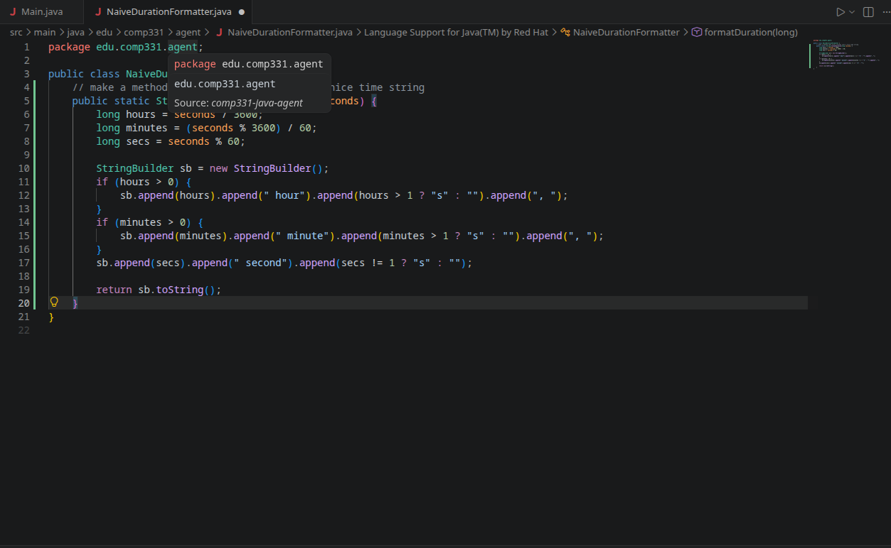
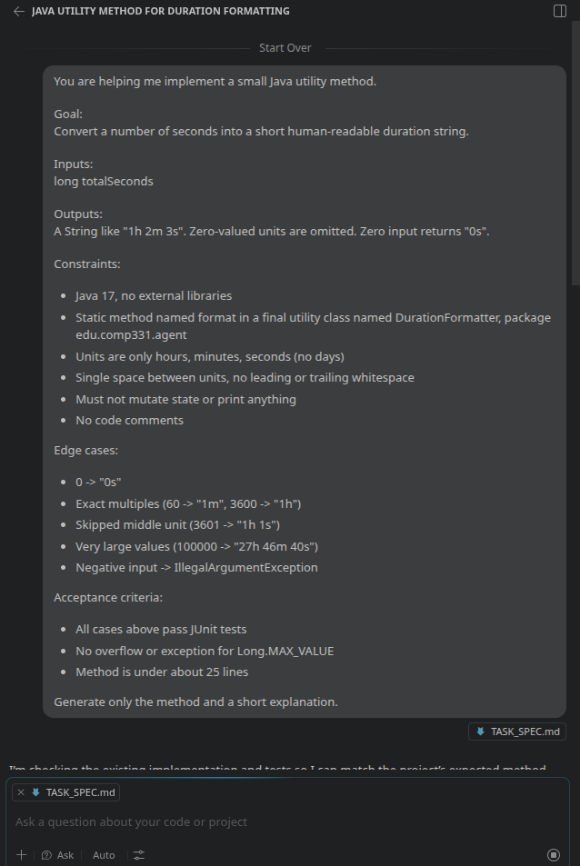
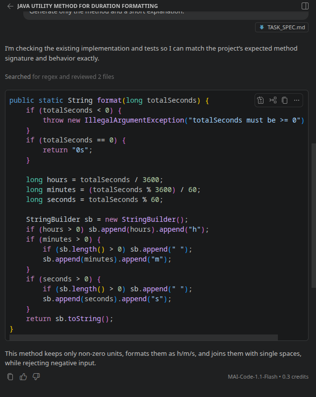
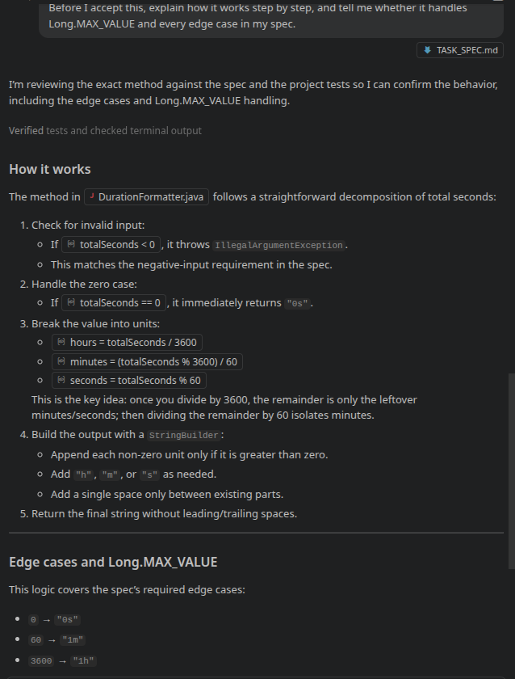
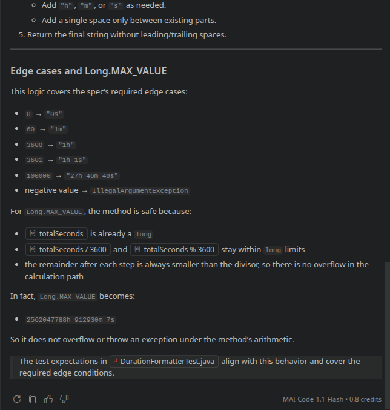

# comp331-java-agent

Lab 1: a Java command-line client for the Gemini API, plus a comparison of naive and structured prompting with GitHub Copilot.

## Setup

- Java 21 (JDK) and Maven 3.9.x
- A Gemini API key from Google AI Studio, set as an environment variable. No keys or `.env` files are committed.

```
export JAVA_HOME=/usr/lib/jvm/java-21-openjdk
export GEMINI_API_KEY="your-key-here"
```

The model is set in `Main.java` as `gemini-3.5-flash-lite`.

Model notes: `gemini-2.5-flash` returned a 404 (no longer available to new users). `gemini-3.8-flash` worked intermittently but returned 503 "high demand" errors and one request timeout. I listed the models available to my key with the `models` endpoint and switched to `gemini-3.5-flash-lite`, which responded reliably.

## Run commands

```
mvn test
mvn exec:java -Dexec.args="Why are structured prompts useful for Java development?"
mvn exec:java -Dexec.args="--verbose Explain what this program does"
```

Verbose output (final model):

```
[verbose] model:  gemini-3.5-flash-lite
[verbose] prompt: Explain what this program does
It looks like you forgot to include the program!

Please paste the code here, and I would be happy to explain what it does, line by line if needed.
[verbose] tokens: prompt=6 output=35 total=41
```

Example from an earlier run on `gemini-3.8-flash`:

```
[verbose] model:  gemini-3.8-flash
[verbose] prompt: Explain what this program does
[verbose] tokens: prompt=6 output=37 total=80
```

The token counts do not add up (6 + 37 is not 80). The API reports `totalTokenCount` separately, and the difference is most likely internal reasoning tokens that count toward the total but are not part of the visible output. On the final model the counts add up (6 + 35 = 41), so no extra reasoning tokens were reported.

## Project structure

- `Main`: parses `--verbose` and the prompt from arguments, reads the API key from the environment, prints the response.
- `GeminiClient`: sends messages to the Gemini `generateContent` endpoint and parses the reply and token counts.
- `Message`: record with `role` and `content`, for later labs.
- `LlmResponse`: record holding response text and token counts.
- `DurationFormatter`: the structured implementation.
- `NaiveDurationFormatter`: the naive Copilot output, left as generated.
- `docs/TASK_SPEC.md`: the structured task specification.

## Commit history

1. `10a7337` Hard-coded prompt to verify the API connection.
2. `fea2b55` Prompt from command-line arguments and `--verbose` flag.
3. `73bba70` Naive Copilot attempt at duration formatting.
4. `2f95cb7` Structured Copilot implementation, spec update, and `Long.MAX_VALUE` test.

## Feature chosen

`format(long totalSeconds)` converts seconds into a duration string such as `1h 2m 3s`. The full specification (goal, inputs, outputs, constraints, edge cases, acceptance criteria) is in `docs/TASK_SPEC.md`.

## Naive Copilot interaction

Inline Copilot, with only this comment typed into an empty class:

```
// make a method that turns seconds into a nice time string
```

Result, accepted without edits (the comment was removed afterward to keep the code comment-free):

```java
public class NaiveDurationFormatter {
    public static String formatDuration(long seconds) {
        long hours = seconds / 3600;
        long minutes = (seconds % 3600) / 60;
        long secs = seconds % 60;

        StringBuilder sb = new StringBuilder();
        if (hours > 0) {
            sb.append(hours).append(" hour").append(hours > 1 ? "s" : "").append(", ");
        }
        if (minutes > 0) {
            sb.append(minutes).append(" minute").append(minutes > 1 ? "s" : "").append(", ");
        }
        sb.append(secs).append(" second").append(secs != 1 ? "s" : "");

        return sb.toString();
    }
}
```

During this attempt Copilot had no access to any other project file. It saw only the comment and the empty class, so it had no existing implementation or tests to draw from.

Evidence: [naive-copilot.txt](docs/evidence/naive-copilot.txt) contains the exact comment, Copilot's unedited output, and the jshell results.



I ran the naive method on the spec's edge cases with `jshell`:

| Input | Naive output | Spec expects |
| --- | --- | --- |
| 0 | `0 seconds` | `0s` |
| 45 | `45 seconds` | `45s` |
| 60 | `1 minute, 0 seconds` | `1m` |
| 61 | `1 minute, 1 second` | `1m 1s` |
| 3600 | `1 hour, 0 seconds` | `1h` |
| 3601 | `1 hour, 1 second` | `1h 1s` |
| 3723 | `1 hour, 2 minutes, 3 seconds` | `1h 2m 3s` |
| 100000 | `27 hours, 46 minutes, 40 seconds` | `27h 46m 40s` |
| -1 | `-1 seconds` | `IllegalArgumentException` |

## Structured Copilot interaction

I first tried Copilot Chat in Agent mode, which asked to run a bash command. I declined it, switched to Ask mode, and started a new chat so Copilot would only answer in the chat.

Prompt sent (built from the spec):

```
You are helping me implement a small Java utility method.

Goal:
Convert a number of seconds into a short human-readable duration string.

Inputs:
long totalSeconds

Outputs:
A String like "1h 2m 3s". Zero-valued units are omitted. Zero input returns "0s".

Constraints:
- Java 17, no external libraries
- Static method named format in a final utility class named DurationFormatter, package edu.comp331.agent
- Units are only hours, minutes, seconds (no days)
- Single space between units, no leading or trailing whitespace
- Must not mutate state or print anything
- No code comments

Edge cases:
- 0 -> "0s"
- Exact multiples (60 -> "1m", 3600 -> "1h")
- Skipped middle unit (3601 -> "1h 1s")
- Very large values (100000 -> "27h 46m 40s")
- Negative input -> IllegalArgumentException

Acceptance criteria:
- All cases above pass JUnit tests
- No overflow or exception for Long.MAX_VALUE
- Method is under about 25 lines

Generate only the method and a short explanation.
```

The chat did not fit in one screenshot, so it is split into four images:









Copilot's reply began by saying it was checking the existing implementation and tests, so it read my project files, including an earlier version of `DurationFormatter`. Its answer was therefore influenced by repo context as well as by the prompt. The naive attempt had no such context, so the two attempts differ in repo access as well as in prompt quality. This limits how cleanly they can be compared.

Before accepting, I asked Copilot to explain the method step by step and say whether it handles `Long.MAX_VALUE` and each edge case. The explanation is in the chat screenshots above.

The explanation of the logic was accurate. One example in it was wrong: Copilot said `Long.MAX_VALUE` becomes `2562047788h 912930m 7s`. That is impossible, because the minutes value is computed from a remainder below 3600 and so cannot exceed 59. I ran the method with `jshell` and got `2562047788015215h 30m 7s`. I also made an arithmetic mistake of my own when first checking this by hand, which running the code corrected. The method's conclusion (no overflow) was right.

## Accepted, rejected, and revised

- Accepted: Copilot's `format` method as written. It met every item in the spec.
- Revised: I added a no-comments constraint to `TASK_SPEC.md` before prompting.
- Added by me: a `Long.MAX_VALUE` test with the value verified by running the code, not taken from Copilot's explanation.
- Rejected: Copilot's example output for `Long.MAX_VALUE`, which was wrong.
- Declined: the bash command requested in Agent mode.

## Comparison: naive vs structured

- **Correctness:** The naive version printed `1 minute, 0 seconds` for 60 and `1 hour, 0 seconds` for 3600, because it always appends seconds. The structured version omits zero units and returned the expected strings in all tests.
- **Zero and negative input:** The naive version returned `0 seconds` for 0 and `-1 seconds` for -1 with no error. The structured version returns `0s` and throws `IllegalArgumentException`.
- **Format:** The naive version chose a verbose format (`1 hour, 2 minutes`). That was partly my fault, since the comment never specified a format. The spec made the format explicit.
- **Edge cases:** The naive version handled none of the spec's edge cases except the ordinary mixed values. The structured version covered all of them, plus `Long.MAX_VALUE`.
- **Human decisions:** With the naive prompt, I made no decisions and the output made them for me. With the structured prompt, I decided the format, the unit limit (no days), the exception behavior, and the no-comments rule, and I verified Copilot's explanation by running the code.

## Verification

- `mvn test`: `Tests run: 10, Failures: 0, Errors: 0, Skipped: 0`, `BUILD SUCCESS`.
- Manual runs of both `mvn exec:java` commands against the Gemini API.
- `jshell` runs of both formatter versions on the edge cases above.

## AI-assisted development evidence

- Inline Copilot comment and suggestion (naive): [docs/evidence/naive-copilot.txt](docs/evidence/naive-copilot.txt)
- Copilot Chat structured prompt, reply, and explanation before accepting: the four screenshots in `docs/screenshots/` shown in the structured section above
- Git history above shows each stage as a separate commit.

# Lab 2: Sandbox project and evaluation process

Lab 2: a small Java calculator sandbox with a repeatable JUnit evaluation, used to compare two Copilot-assisted iterations of the code.

## Sandbox

`sandbox/calculator` is a standalone Maven project (Java 17, JUnit 5) containing `Calculator.evaluate(String)`, a recursive-descent arithmetic evaluator. It supports `+ - * /`, parentheses, unary minus, decimals, and ignores whitespace. The specification, in the same format as the Lab 1 spec, is `docs/CALCULATOR_SPEC.md`.

## Running the evaluation

Requires a JDK 17 or newer and Maven 3.9.x. The sandbox has its own `pom.xml`, so run it from its directory. The root `mvn test` does not include it.

```
export JAVA_HOME=/usr/lib/jvm/java-21-openjdk
git clone <repo-url>
cd comp331-java-agent/sandbox/calculator
mvn test
```

Comment check (AC6), run from the repository root. It should print nothing:

```
grep -rnE '//|/\*' sandbox/calculator/src
```

## Acceptance criteria

| ID | Criterion | Check | Automated |
| --- | --- | --- | --- |
| AC1 | Arithmetic and decimals are correct | `addition`, `subtraction`, `multiplication`, `divisionGivesFraction`, `decimalOperands`, `singleNumber`, `whitespaceIgnored` | Yes |
| AC2 | Precedence and left-associativity | `multiplicationBeforeAddition`, `divisionBeforeSubtraction`, `subtractionIsLeftAssociative`, `divisionIsLeftAssociative` | Yes |
| AC3 | Parentheses and unary minus | the parentheses and unary-minus tests, plus `unaryMinusBindsBeforeMultiplication` | Yes |
| AC4 | Division by zero throws `ArithmeticException` | `divisionByZeroRejected`, `divisionByZeroResultRejected` | Yes |
| AC5 | Null, blank, or malformed input throws `IllegalArgumentException` | `invalidInputRejected` (20 cases) | Yes |
| AC6 | No code comments | `grep -rnE '//\|/\*' sandbox/calculator/src` prints nothing | Yes, but run by hand |
| AC7 | Methods under about 25 lines, readable, final class | Human review | No |
| AC8 | Behavior matches the intent of the spec | Human review | No |

## Commit history

1. `4d4c297` Calculator sandbox, expanded tests, and the flawed Copilot Iteration 1 (17 expected failures).
2. `21de5ab` Copilot Iteration 2, which passes all 45 tests.

## Iteration results

Both iterations ran against the same 45 tests. Between the two commits only `Calculator.java` changed in the source tree. `git diff --stat` showed no change to `CalculatorTest.java`, so the tests were not weakened.

| | Iteration 1 (flawed) | Iteration 2 (fixed) |
| --- | --- | --- |
| Commit | `4d4c297` | `21de5ab` |
| Code origin | Copilot Chat (Ask mode), deliberately incomplete | Copilot Chat (Ask mode), given the spec, the flawed code, the tests, and the Maven failure summary |
| Approach | Splits the string into tokens and evaluates strictly left to right | Recursive-descent parser in a nested `Parser` class |
| `mvn test` result | `Tests run: 45, Failures: 7, Errors: 10` (17 failing, 28 passing), `BUILD FAILURE` | `Tests run: 45, Failures: 0, Errors: 0`, `BUILD SUCCESS` |
| Evidence | [calculator-iteration-1.txt](docs/evidence/calculator-iteration-1.txt), [chat](docs/evidence/calculator-iteration-1-chat.txt) | [calculator-iteration-2.txt](docs/evidence/calculator-iteration-2.txt), [chat](docs/evidence/calculator-iteration-2-chat.txt) |

Before Iteration 1, the same 45 tests passed against my earlier calculator: [calculator-baseline-45-tests.txt](docs/evidence/calculator-baseline-45-tests.txt).

I asked Copilot to leave out operator precedence, unary minus, the division-by-zero check, and the check for leftover input. The evaluation caught each of those:

| Flaw I requested | Tests that caught it |
| --- | --- |
| No precedence | `multiplicationBeforeAddition` (got 20, expected 14), `divisionBeforeSubtraction` (got 3, expected 8) |
| No unary minus | `leadingUnaryMinus`, `unaryMinusAfterOperator`, `subtractNegativeOperand`, `negativeZeroEqualsZero`, `doubleMinusIsDoubleNegation`, `negatedParenthesesGroup`, `unaryMinusBindsBeforeMultiplication` (all `NumberFormatException` on `"-"`) |
| No division-by-zero check | `divisionByZeroRejected` (nothing thrown) |
| No leftover-input check | `invalidInputRejected` case `"2 3"` (accepted) |

Copilot's first version also had flaws I did not ask for:

- It could not parse parentheses, so `nestedParentheses`, `parenthesesOverridePrecedence` and `parenthesizedNegative` failed with `NumberFormatException` on `"("`. `divisionByZeroResultRejected` failed for the same reason, throwing `NumberFormatException` instead of `ArithmeticException`.
- `"2+"` crashed with `ArrayIndexOutOfBoundsException` instead of `IllegalArgumentException`.
- `"1.2e3"` was accepted, because `Double.parseDouble` allows scientific notation.

Copilot did not include the `package` line in its first reply, which would have caused a compile error. I added that line by hand.

## Copilot gap review

After writing my first test set, I asked Copilot (Ask mode) to list edge cases my tests were missing, with the spec and the test class attached and an instruction not to write the implementation or change my tests. The prompt and reply are in [calculator-copilot-gap-review.txt](docs/evidence/calculator-copilot-gap-review.txt). Copilot suggested 18 cases. I added 5, and the 40 existing cases plus these 5 gave the 45-test suite (`Tests run: 45`, `BUILD SUCCESS`).

## Accepted, rejected, and revised

- Accepted: Copilot's deliberately flawed first version as Iteration 1, with one hand edit (the missing `package` line).
- Accepted: Copilot's Iteration 2 `Calculator.java` as written, after reading it for comments and the package line, then running `mvn test` and confirming with `git diff --stat` that the tests were untouched.
- Accepted: five test cases from the gap review: `0/5`, `-(2+3)*2`, and the invalid inputs `"."`, `"1.2e3"` and `"2 - +3"`. Copilot suggested them. Each was verified with `mvn test`.
- Rejected: `((2+3)`, `(2+3))` and `3+`, which duplicate my existing `"(2+3"`, `"2+3)"` and `"2+"`.
- Rejected: `2--3`, `2+-3` and `1/-2`, which are close to my existing `"1 - -1"` and `"2*-3"`.
- Rejected: `0.0000000001 + 0.0000000002`, because my `DELTA` of `1e-9` would let it pass even if the result were 0.
- Rejected: `1/0.0`. Copilot's reasoning implied an integer-zero path, but the parser reads every number as a `double`.
- Not added: `8/2*3`, `5-(3+2)*2`, `-0.5 + 0.5` and `((2+3))`, which I judged covered by my existing tests. `2(3+4)` has no test of its own. I ran it in `jshell` against Iteration 2 and it throws `IllegalArgumentException`, because `(` is not an operator, the same check that rejects `"2 3"`.
- Added by me: the original calculator and its original 24 test methods (40 cases), before Copilot was involved.

## What the evaluation caught and did not catch

Caught:

- All four flaws I asked Copilot to introduce (see the table above).
- Two flaws I did not ask for: no parenthesis support, and `"2+"` crashing with `ArrayIndexOutOfBoundsException`.
- `"1.2e3"` being accepted. This case came from Copilot's gap review, so that suggestion exposed a real flaw.

Not caught:

- **Wrong exception types were mostly invisible.** `NumberFormatException` is a subclass of `IllegalArgumentException`, so `assertThrows(IllegalArgumentException.class, ...)` accepted it. Against Iteration 1, only 3 of the 20 `invalidInputRejected` cases failed, even though that version could not parse parentheses at all. A crash and a deliberate rejection look the same to this test.
- **Method length.** The spec says methods should be under about 25 lines. Iteration 2's `parseFactor` is about 36 lines. No test checks this, so it is a human-review item.
- **Untested inputs.** No test covers very long digit strings, deeply nested parentheses, or non-ASCII digits. I did not run any of these, so I do not know how the parser behaves.
- **Readability and spec intent** (AC7, AC8).

## Connection to the Lab 1 specification

`docs/CALCULATOR_SPEC.md` uses the same format as `docs/TASK_SPEC.md` (goal, inputs, outputs, constraints, edge cases, acceptance criteria), and carries over the Lab 1 constraints.

| Lab 1 criterion | Lab 2 enforcement |
| --- | --- |
| Cases covered by JUnit tests that pass via `mvn test` | Automated (AC1 to AC5) |
| Java 17, no external libraries | Automated: `maven.compiler.release` is 17 and the only dependency is JUnit (test scope) |
| No code comments | Automated check (AC6), run by hand with `grep` |
| Final utility class | Human review (AC7) |
| Method under about 25 lines | Human review (AC7) |
| Behavior matches the intent of the spec | Human review (AC8) |

## Verification

- `mvn test` on the original calculator and tests: `Tests run: 40, Failures: 0, Errors: 0, Skipped: 0`.
- After adding the Copilot-suggested cases: `Tests run: 45, Failures: 0, Errors: 0, Skipped: 0`.
- Iteration 1: `Tests run: 45, Failures: 7, Errors: 10`, `BUILD FAILURE`.
- Iteration 2: `Tests run: 45, Failures: 0, Errors: 0, Skipped: 0`, `BUILD SUCCESS`.
- Comment check: `grep -rnE '//|/\*' sandbox/calculator/src` printed nothing.

## AI-assisted development evidence

- Copilot gap review (prompt and reply): [docs/evidence/calculator-copilot-gap-review.txt](docs/evidence/calculator-copilot-gap-review.txt)
- Iteration 1 and Iteration 2 Copilot chats: [calculator-iteration-1-chat.txt](docs/evidence/calculator-iteration-1-chat.txt), [calculator-iteration-2-chat.txt](docs/evidence/calculator-iteration-2-chat.txt)
- Maven output for each run: the `calculator-*.txt` files in `docs/evidence/`.
- Passing run screenshot: `docs/screenshots/TestsPassLab2.png`.
- Git history above shows each iteration as a separate commit.

# Lab 3: Tool layer for the coding agent

Lab 3: Java tools that a coding agent can use on the Lab 2 sandbox project (list files, read a file, write a file, run the tests), with path-traversal protection, JUnit tests for each tool, and a demo that runs them together. The model does not call these tools yet. They are tested directly from Java and JUnit.

## Tool architecture

Every tool implements one interface:

```java
public interface AgentTool {
    String name();
    String description();
    String execute(Map<String, String> args);
}
```

`name()` and `description()` are what the model will later be shown. `execute` takes the arguments as a string map and always returns a string. Blocked or failed calls return a string starting with `Error:` and never throw, so a bad call cannot crash the agent loop later.

All file tools share one `Sandbox` object, built from the sandbox directory `sandbox/calculator` (the Lab 2 project). A tool never opens the path the model gave it. It asks `Sandbox.resolve()` for a checked path and opens only that.

## Project structure

- `AgentTool`: the common interface above.
- `Sandbox`: holds the one allowed root directory and turns a user-supplied path into a checked absolute path, or throws `IllegalArgumentException`.
- `ListFilesTool`, `ReadFileTool`, `WriteFileTool`: the file tools.
- `RunJavaTestsTool`: runs `mvn test` in the sandbox. Takes a `CommandRunner` so the tests can use a fake instead of starting Maven.
- `ToolDemo`: the manual driver. `Main` calls it when the first argument is `--tool-demo`, before the prompt and API key checks.
- Tests: one test class per tool, plus `SandboxTest` and `ToolDemoTest`.
- `docs/evidence/ReproduceFindings.java`: reproduces the Copilot findings described below.

## Tool reference

| Tool | Arguments | What it does | Refused or error cases |
| --- | --- | --- | --- |
| `list_files` | `directory` (optional, default `.`) | One line per entry: name, size in bytes, `is_dir`. Sorted by name. | Missing directory, a file instead of a directory, blank path, anything outside the sandbox |
| `read_file` | `file_path` | Returns a UTF-8 text file, cut off at 10,000 characters with a truncation notice. | Missing file, a directory, blank or missing argument, binary (non-UTF-8) file, anything outside the sandbox |
| `write_file` | `file_path`, `content` | Creates or overwrites a UTF-8 file and creates missing parent directories. | A directory or the sandbox root, any symbolic link, missing argument, anything outside the sandbox |
| `run_java_tests` | none | Runs `mvn -B test` in the sandbox root with a 120 second timeout. Returns the exit code and the last 10,000 characters of output. | Any argument at all, missing `pom.xml`, Maven not installed, timeout |

## Sandbox rules

`Sandbox.resolve(userPath)` does the following, in order:

1. Rejects null and blank paths.
2. Resolves the path against the sandbox root and normalizes it (removes `.` and `..`).
3. Rejects it unless the normalized path starts with the root, using `Path.startsWith` and not a string prefix check. A string check would let a sibling folder such as `calculator-evil` through.
4. Finds the nearest part of the path that exists and rejects it if the real path of that part (after following symbolic links) is outside the root.
5. Returns the normalized path, which is what the tools open.

Examples, with the sandbox at `sandbox/calculator`:

| Input | Result |
| --- | --- |
| `README.md`, `docs/../README.md`, `new/Out.txt` | Allowed |
| `../README.md`, `a/../../b` | Blocked |
| An absolute path outside the sandbox | Blocked |
| `<root>/../../nonexistent.txt` (absolute, with `..`) | Blocked |
| `../calculator-evil/x.txt` | Blocked |
| A symlink inside the sandbox pointing outside it | Blocked |
| A path through a symlinked directory that points outside | Blocked |
| `outer/../secret.txt` where `outer` is a symlink | Allowed, but returns `<root>/secret.txt`, which is inside the sandbox |

## Running the tools

Requires JDK 17 or newer and Maven 3.9.x. Run from the repository root.

```
mvn test
mvn exec:java -Dexec.args="--tool-demo"
```

The demo needs no API key. It lists the sandbox, reads `Calculator.java`, writes `notes/agent-demo.txt`, reads it back, makes three blocked calls, and runs the sandbox tests. Output:

```
Sandbox: /home/nuffis/School/Fall/Repo/comp331-java-agent/sandbox/calculator

=== 1. list_files directory=. ===
- .gitignore: file_size=8 bytes, is_dir=false
- pom.xml: file_size=1044 bytes, is_dir=false
- src: file_size=16 bytes, is_dir=true
- target: file_size=172 bytes, is_dir=true

=== 2. read_file file_path=src/main/java/edu/comp331/sandbox/calculator/Calculator.java ===
package edu.comp331.sandbox.calculator;

public final class Calculator {
public static double evaluate(String expression) {
if (expression == null || expression.trim().isEmpty()) {
throw new IllegalArgumentException("Invalid expression");
}
Parser parser = new Parser(expression);
double result = parser.parseExpression();
parser.skipSpaces();
if (parser.hasMore()) {
throw new IllegalArgumentException("Invalid expression");
... (96 more lines) ...

=== 3. write_file file_path=notes/agent-demo.txt ===
Wrote 26 characters to notes/agent-demo.txt

=== 4. read_file file_path=notes/agent-demo.txt (read back) ===
Written by the tool demo.


=== 5. BLOCKED read_file file_path=../../README.md ===
Error: Path is outside the sandbox: ../../README.md

=== 6. BLOCKED write_file file_path=../escape.txt ===
Error: Path is outside the sandbox: ../escape.txt

=== 7. BLOCKED run_java_tests command="rm -rf /" ===
Error: run_java_tests takes no arguments; it only runs 'mvn test' in the sandbox

=== 8. run_java_tests ===
Command: mvn -B test
Exit code: 0 (tests passed)
--- output ---
... (26 more lines) ...
[INFO] Tests run: 45, Failures: 0, Errors: 0, Skipped: 0, Time elapsed: 0.105 s -- in edu.comp331.sandbox.calculator.CalculatorTest
[INFO] 
[INFO] Results:
[INFO] 
[INFO] Tests run: 45, Failures: 0, Errors: 0, Skipped: 0
[INFO] 
[INFO] ------------------------------------------------------------------------
[INFO] BUILD SUCCESS
[INFO] ------------------------------------------------------------------------
[INFO] Total time:  0.934 s
[INFO] Finished at: 2026-11-06T15:15:22-05:00
[INFO] ------------------------------------------------------------------------

Demo result: OK
```

Step 8 runs the Lab 2 calculator suite (45 tests) through the new tool. The demo leaves `sandbox/calculator/notes/agent-demo.txt` behind. Rerunning overwrites it.

## Commit history

1. `<hash>` `AgentTool` interface and `Sandbox` path guard with tests.
2. `<hash>` `ListFilesTool` with tests.
3. `<hash>` `ReadFileTool` with tests.
4. `<hash>` `WriteFileTool` with tests.
5. `<hash>` `RunJavaTestsTool` with tests.
6. `<hash>` `--tool-demo` driver.
7. `<hash>` README, reproduction file, and evidence.

## Tests

| Test class | Tests | What it covers |
| --- | --- | --- |
| `SandboxTest` | 24 | Allowed paths, `..` traversal, absolute paths, sibling folders, null and blank input, symlinks to files and folders, symlink followed by `..` |
| `ListFilesToolTest` | 17 | Listing, sorting, empty folders, missing directory, file as directory, traversal, symlinks |
| `ReadFileToolTest` | 20 | Reading, the 10,000 character boundary (exactly at, one over, far over), missing and binary files, traversal, symlinks. Blocked cases also check that the secret file's contents never appear. |
| `WriteFileToolTest` | 24 | Create, overwrite, parent folders, unicode, missing arguments, traversal, symlinks including dangling ones. Blocked cases check that nothing was written outside. |
| `RunJavaTestsToolTest` | 15 | Fixed command and working directory, pass and fail results, timeout, long output, rejected arguments and injection strings, missing `pom.xml`, Maven not installed. Two tests use the real process runner with `java -version`. |
| `ToolDemoTest` | 4 | All demo steps, exactly three blocked calls, the demo file written inside the sandbox only, a missing sandbox |
| `DurationFormatterTest` | 10 | Lab 1, unchanged |

The `RunJavaTestsTool` unit tests use a fake runner, so they do not start Maven. The only real Maven run is the demo.

## Connection to Lab 2

The sandbox root is the Lab 2 `sandbox/calculator` project. `run_java_tests` runs the Lab 2 evaluation (`mvn test`, 45 tests), so the agent will later be able to write code and check it against the same acceptance tests.

## Copilot interactions

All chats were in Ask mode in a new chat. In the first six I attached no files, but Copilot's replies referenced `SandboxTest.java`, `AgentTool.java` and `ReadFileToolTest.java`, so VS Code was supplying workspace context on its own. For the last chat I attached the files on purpose.

| Chat | Copilot's output | Evidence |
| --- | --- | --- |
| `AgentTool` and `Sandbox` design | An interface, a `Sandbox` class, and 14 test cases (6 allowed, 8 blocked) | [tools-copilot-sandbox-chat.txt](docs/evidence/tools-copilot-sandbox-chat.txt) |
| Review of `Sandbox` | One claimed escape: a symlink followed by `..` | [tools-copilot-review-chat.txt](docs/evidence/tools-copilot-review-chat.txt) |
| `ListFilesTool` tests | 11 cases (5 success, 6 blocked) | [tools-copilot-list-chat.txt](docs/evidence/tools-copilot-list-chat.txt) |
| `ReadFileTool` tests | 16 cases (6 success, 10 blocked) | [tools-copilot-read-chat.txt](docs/evidence/tools-copilot-read-chat.txt) |
| `WriteFileTool` tests | 18 cases (5 success, 13 blocked) | [tools-copilot-write-chat.txt](docs/evidence/tools-copilot-write-chat.txt) |
| `RunJavaTestsTool` tests | 12 cases and a security rule | [tools-copilot-run-chat.txt](docs/evidence/tools-copilot-run-chat.txt) |
| Review of all tools for escape risks | 5 findings: 2 presented as real risks, 3 as not risks | [tools-copilot-review-all-chat.txt](docs/evidence/tools-copilot-review-all-chat.txt) |

## Accepted, rejected, and revised

Sandbox and interface:

- Accepted: the allowed and blocked grouping, the test names, and rejecting null and blank paths.
- Revised: Copilot's `AgentTool.execute(Path sandboxRoot, String userPath, Object... args)` returned `Object` and handed each tool the raw root. I changed it to `String execute(Map<String, String>)` so each tool holds a `Sandbox` and cannot skip the path checks.
- Revised: Copilot's tests used a hardcoded `/tmp/sandbox`, which does not exist. I used JUnit `@TempDir`.
- Rejected (unsafe): Copilot used `toRealPath(LinkOption.NOFOLLOW_LINKS)` and described it as the symlink check. That option tells Java not to follow links, so a symlink inside the sandbox pointing outside it was allowed. I removed `NOFOLLOW_LINKS`.
- Rejected (unsafe): Copilot only normalized relative paths. An absolute path such as `<root>/../../nonexistent.txt` kept its `..` and was allowed. I normalize every path.
- Rejected (false alarm): Copilot's review of `Sandbox` said `link/../etc/passwd` escapes because `normalize()` hides the symlink. `resolve()` returns the normalized path and the tools open that, so the symlink is never followed and the result is inside the sandbox. I added regression tests (`symlinkFollowedByDotDotStaysInsideSandbox`, `symlinkFollowedByDotDotWritesInsideSandboxOnly`) and left the code unchanged.

`ListFilesTool`:

- Accepted: three cases I did not have: `docs/../docs` gives the same listing as `docs`, an absolute path inside the root, and a symlink inside the sandbox pointing inside it.
- Rejected: Copilot's tests called `Map.of("path", ...)`. The tool reads `directory`, as `get_files_info` does, so the argument would have been ignored and the tool would have listed the root.
- Rejected: Copilot said a null path should be an error. A missing path lists the root, so the agent can call the tool with no arguments. A blank path is still an error.
- Rejected: its `ERROR:` prefix and lowercase `not a directory`. The tools use `Error:` and `Not a directory`.
- Rejected: cases that duplicated tests I already had.

`ReadFileTool`:

- Accepted: `./README.md`, and a file reached through a symlinked folder that points outside the sandbox.
- Rejected: the `.` variant of the dot-relative case, because `.` is a directory and returns `Not a file`.
- Rejected: "traversal after a symlink returns an error". `outer/../README.md` normalizes to `README.md` inside the sandbox, which is the same false alarm as above.
- Rejected: duplicates of my existing tests.

`WriteFileTool`:

- Accepted: an absolute path with `..` into the outside folder, an absolute path into a sibling folder, and a symlink followed by `..`. For the last one I changed the expectation from "blocked or normalized" to what happens: the file is written inside the sandbox and nothing appears outside.
- Added by me: dangling symlinks, meaning a symlink inside the sandbox that points to a file outside it that does not exist yet. `Sandbox.resolve()` treats such a link as missing, because `Files.exists` follows links, and checks the folder above it instead. A write through it would create a file outside the sandbox. `WriteFileTool` therefore refuses any symbolic link as the target, and `danglingSymlinkToOutsideFileWritesNothing` covers it. Copilot's test plan had no dangling-link case and would have passed without this guard.
- Added by me: a symlink inside the sandbox pointing inside it is also refused for writes, on purpose.

`RunJavaTestsTool`:

- Accepted: the rule to use a fixed argument list with `ProcessBuilder`, never a shell string, and Copilot's injection strings as test inputs.
- Rejected (too permissive): Copilot's tests assumed the tool receives a command string and checks it against an allowlist (`mvn test` accepted, `mvn -q test` rejected). The tool takes no arguments at all and always runs `mvn -B test`, so there is no command text to parse or get wrong. Its own advice at the end of the reply, a fixed argument list, matched my design.
- Rejected: tests that need a real failing Maven project or a machine with no Maven. A fake runner covers failing runs and a missing `mvn` without depending on the machine.
- Rejected: a blank or null command being an error. A null argument map is a valid call.

Final review of all tools:

- Accepted: the check-then-use race is real (see below).
- Rejected: its "High" severity rating.
- Not mentioned by Copilot: `write_file` followed by `run_java_tests` runs arbitrary code. Added to the limitations.

## Copilot findings I tested

[ReproduceFindings.java](docs/evidence/ReproduceFindings.java) reproduces the three claims below. Run `mvn compile` first, then:

```
java -cp target/classes docs/evidence/ReproduceFindings.java
```

Output: [tools-reproduction.txt](docs/evidence/tools-reproduction.txt).

1. **Copilot's `Sandbox` versus mine.** Copilot's version allowed a symlink inside the sandbox pointing to a file outside it, and an absolute path with `..` to a file that does not exist. Mine blocked both.
2. **The claimed symlink-plus-`..` escape.** With `outer` as a symlink to a folder outside the sandbox, `outer/../secret.txt` made the sandbox return `<root>/secret.txt`, which is inside the root. No escape.
3. **The check-then-use race.** `Sandbox.resolve()` checks a path and the tool opens it a moment later. A background thread that keeps swapping a folder between a normal directory and a symlink to an outside folder, while `WriteFileTool` writes `swap/x.txt`, produced `<N>` files outside the sandbox in `<N>` write attempts over 10 seconds. The result varies between runs. This is a real flaw, but I rate it low for this design: the tools run one at a time and none of them creates a symlink, so the model has no way to run something concurrently except through `run_java_tests`, and that tool already allows arbitrary code (see below). I did not fix it. Java has no call that opens a path without following symlinks in every part of it.

## What the tests caught and did not catch

Caught:

- Both flaws in Copilot's `Sandbox` (see above). Each input is now a test: `blocksSymlinkToFileOutsideRoot` and `blocksAbsoluteTraversalToMissingFile`.
- The dangling symlink hole, found while designing the `WriteFileTool` tests.
- The data-leak cases: the read, list and write tests check that the secret file's contents never appear in the output and that nothing is written outside, not only that an `Error:` string is returned.

Not caught:

- **The race.** The test suite runs one call at a time and cannot trigger it. The reproduction file is timing-based, so I kept it out of `mvn test`.
- **Arbitrary code through the tests.** No test can show that the agent can write a test class and then run it.
- **A real Maven run.** The unit tests use a fake runner. Only the demo runs the real `mvn test`.
- **Windows.** `RunJavaTestsTool` uses `mvn.cmd` on Windows, which I did not test. The symlink tests skip themselves where symlinks are unavailable. On my machine none were skipped.
- **Binary versus text.** `read_file` treats a file as binary only if it is not valid UTF-8.

## Current limitations

- **The sandbox is a path guard, not isolation.** `write_file` plus `run_java_tests` lets the agent write a test that runs any code as my user, so this should only be pointed at a throwaway project.
- **The check-then-use race** described above is not fixed.
- **No size limit on `write_file` content.** Reading is capped at 10,000 characters, but writing is not.
- **120 second timeout.** The first run on a fresh machine may need to download dependencies and time out.
- **`mvn` comes from the `PATH`.** A malicious `mvn` earlier on the `PATH` would be run. The model cannot change this.
- **The sandbox path is relative to the working directory.** The demo must be run from the repository root.
- **Error messages repeat the path the model gave.** This is harmless here, but the text should not be trusted as instructions once the model reads it.
- **The model does not call the tools yet.** They are only tested directly.

## Verification

- `mvn clean test`: `Tests run: 114, Failures: 0, Errors: 0, Skipped: 0`, `BUILD SUCCESS`. Output: [tools-all-tests.txt](docs/evidence/tools-all-tests.txt).
- Each tool's own run: `tools-sandbox-tests.txt`, `tools-list-files-tests.txt`, `tools-read-file-tests.txt`, `tools-write-file-tests.txt`, `tools-run-tests-tests.txt`, `tools-demo-tests.txt` in `docs/evidence/`.
- `mvn exec:java -Dexec.args="--tool-demo"`: `Demo result: OK`, with the sandbox's 45 tests passing. Output: [tools-demo-output.txt](docs/evidence/tools-demo-output.txt).
- Reproduction of the Copilot findings: [tools-reproduction.txt](docs/evidence/tools-reproduction.txt).

## AI-assisted development evidence

- Copilot chats (prompt and reply): the seven `tools-copilot-*-chat.txt` files in `docs/evidence/`, linked in the table above.
- Maven output for each run: the `tools-*.txt` files in `docs/evidence/`.
- Git history above shows each tool as a separate commit.
